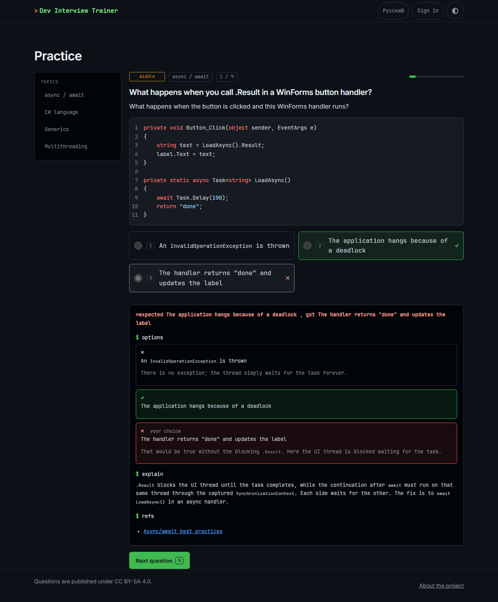

# Dev Interview Trainer

A Blazor web app for preparing for developer job interviews. Questions are
tagged by level (junior, middle, senior, lead, architect) and topic, come in six
types (open, single, multi, output, find-bug, situation), and every answer comes
with an explanation and source links. The first stack is .NET; the model supports
more stacks. The UI and the content are available in Russian and English.




The screenshots come from the end-to-end test run, which uses fixture content,
not the real question bank.

## Status

The project is built in plans:

- **Plan 1 (done):** the content format and tooling, the question bank seed, and
  the public read-only site: home, catalog, topic and question pages in both
  languages, SEO, caching.
- **Plan 2 (this state):** Telegram sign-in (including the dev bot), the `/api`,
  and the Practice, Mock, Review and profile islands with spaced repetition and
  progress, plus the admin page.
- **Plan 3 (not started):** deployment and operations.

The design and the reasons behind it:
`docs/superpowers/specs/2026-11-11-dev-interview-trainer-design.md`.

## Modes

Every mode is an interactive page under `/{culture}/{stack}/` (for example
`/en/dotnet/practice`). Answers are kept in the browser first and sent to the
server when you are signed in.

- **Practice** (`/practice`): pick levels, topics, types and a status (new, due,
  all), answer one question at a time, see the worked answer after each one.
- **Mock interview** (`/mock`): a set of questions for one level with an optional
  timer and no feedback until the end, then a self-assessment of the open
  questions and a summary by topic.
- **Review** (`/review`, sign-in required): the questions that are due today,
  most overdue first. A choice question first asks whether you can answer it
  without seeing the options; the options appear, shuffled, when you ask for them.
- **Profile** (`/profile`, sign-in required): streak, answered and due questions,
  the next review date, progress per topic and per level, recent mock interviews.
  Answers you gave in this browser before signing in are listed here and are
  added to your account only if you choose **Import into my account**; you can
  discard them instead.

## Quick start

You need the .NET SDK pinned in `global.json` and Docker.

1. Start PostgreSQL:

   ```bash
   docker run --name dit-postgres -e POSTGRES_PASSWORD=dev -e POSTGRES_DB=trainer -p 127.0.0.1:5432:5432 -d postgres:17-alpine
   ```

2. Tell the app how to reach it. The connection string is read from the
   `ConnectionStrings__Trainer` environment variable (or from user secrets) and
   is never committed to the repository. Run the app in the Development
   environment, and let it apply migrations on startup. That flag is accepted
   only in Development; in any other environment the app refuses to start.

   The password and the connection string below are throwaway values for a
   database bound to `127.0.0.1` on your machine. Never reuse them for any other
   environment. The exports apply to the current shell session only.

   Bash:

   ```bash
   export ConnectionStrings__Trainer="Host=localhost;Port=5432;Database=trainer;Username=postgres;Password=dev"
   export ASPNETCORE_ENVIRONMENT=Development
   export App__ApplyMigrationsOnStartup=true
   ```

   PowerShell:

   ```powershell
   $env:ConnectionStrings__Trainer = "Host=localhost;Port=5432;Database=trainer;Username=postgres;Password=dev"
   $env:ASPNETCORE_ENVIRONMENT = "Development"
   $env:App__ApplyMigrationsOnStartup = "true"
   ```

   To use user secrets instead of the environment variable, run
   `dotnet user-secrets set "ConnectionStrings:Trainer" "<connection string>" --project src/Trainer.Web`
   (the project already has a `UserSecretsId`; the secrets live in your user
   profile, outside the repository).

3. Run the site from the repository root:

   ```bash
   dotnet run --project src/Trainer.Web
   ```

   On start the app imports `content/` into the database
   (`App:ContentRoot` is `../../content` in Development). Open the address that
   `dotnet run` prints, `http://localhost:5000` with the default `http` launch
   profile. `/` redirects to `/en` or `/ru`. `/health/ready` answers 200 once the
   import has finished.

To stop and remove the database: `docker rm -f dit-postgres`.

## Sign-in in development

Sign-in uses Telegram OpenID Connect. Without a bot the app runs normally and the
sign-in page says "Sign-in is not configured". To sign in locally:

1. In `@BotFather`, create a separate bot for development. Never reuse the
   production bot: its secret must stay on the server.
2. Turn on OIDC for that bot. BotFather shows the Client ID (the bot id) and
   issues the Client Secret.
3. Register the redirect URI `https://localhost:7180/signin-telegram`. Telegram
   matches it literally, scheme and port included. Whether BotFather accepts a
   `localhost` redirect URI has not been verified yet; record the outcome here
   after the first try.
4. Store the credentials as user secrets, run from the repository root:

   ```bash
   dotnet user-secrets set "TelegramOidc:ClientId" "<bot id>" --project src/Trainer.Web
   dotnet user-secrets set "TelegramOidc:ClientSecret" "<client secret>" --project src/Trainer.Web
   ```

   The secret never goes into `appsettings*.json`; a test fails if it does.
5. To get the Admin role, add your Telegram user id:

   ```bash
   dotnet user-secrets set "App:AdminTelegramIds" "<your Telegram user id>" --project src/Trainer.Web
   ```

   Several ids are comma-separated. The list is read at startup, so restart the
   app after a change.
6. Trust the development certificate once (`dotnet dev-certs https --trust`) and
   run the `https` profile, which listens on `https://localhost:7180`:

   ```bash
   dotnet run --project src/Trainer.Web --launch-profile https
   ```

   The session and state cookies are `Secure`, so sign-in does not work over the
   `http` profile.
7. Open `https://localhost:7180/en/signin` and choose "Sign in with Telegram".

## Tests

```bash
dotnet build -warnaserror
dotnet test --filter-not-trait "Category=E2E" --filter-not-trait "Category=Docker" --filter-not-trait "Category=Release" --ignore-exit-code 8
dotnet test --filter-trait "Category=Docker" --ignore-exit-code 8
dotnet test --filter-trait "Category=E2E" --ignore-exit-code 8
dotnet run --project tools/Trainer.ContentCli -- validate
```

The integration tests start PostgreSQL in a Testcontainers container, so Docker
must be running. The `Docker` category runs snippets in the sandbox. The `E2E`
category needs a one-time browser install: after building, run
`pwsh tests/Trainer.Web.E2E/bin/Debug/net10.0/playwright.ps1 install chromium`.
`--ignore-exit-code 8` is there because some test projects have no tests in a
given category. The `Release` category smoke-tests and times a published Release
build; it skips unless `DIT_RELEASE_PUBLISH_DIR` and `DIT_RELEASE_CONNECTION` are
set, and `docs/performance.md` describes how to run it.

## Contribute questions

The question bank lives in `content/`. One question is one YAML file with both
languages. The full format, the quality bar and the checklist are in
`docs/content-guide.md`. In short:

1. Generate a skeleton:
   `dotnet run --project tools/Trainer.ContentCli -- new-question dotnet async my-slug single`
2. Fill in both `ru` and `en`, add a real source link, set `meta.verified`.
3. Check it: `dotnet run --project tools/Trainer.ContentCli -- validate`, and for
   `output` and `find-bug` questions `-- run-snippets` (needs Docker). Optionally
   `-- check-links` tests every source URL over the network (CI runs it weekly).
4. Open a pull request.

## Documentation

- `docs/content-guide.md`: how to write a question, field reference, issue codes.
- `docs/architecture.md`: layers, content flow, caching, sign-in, security
  headers, migrations policy.
- `docs/performance.md`: the island performance targets, the throttling profile,
  how to measure and every measurement so far.
- `docs/adr/`: architecture decision records.
- `AGENTS.md`: rules for contributors and AI coding agents.
- `docs/superpowers/specs/`: the design.

## Licence

Code: MIT (`LICENSE`). Question bank in `content/`: CC BY-SA 4.0 (`content/LICENSE`).
