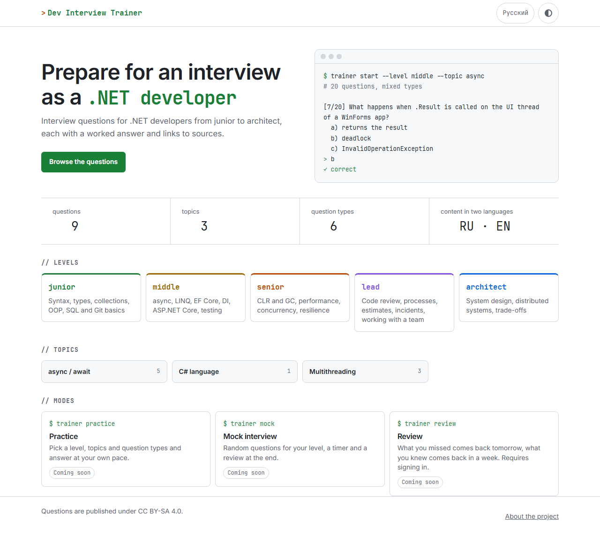
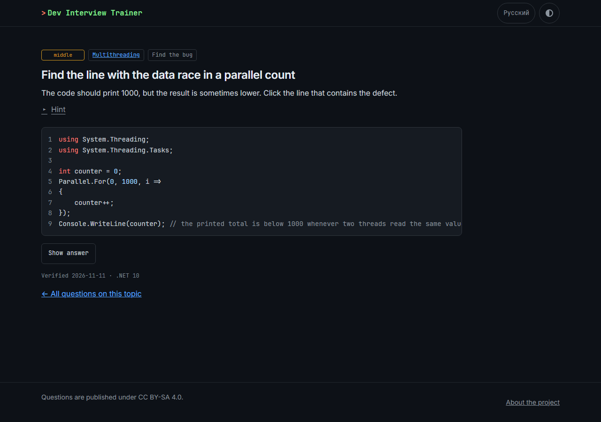

# Dev Interview Trainer

A Blazor web app for preparing for developer job interviews. Questions are
tagged by level (junior, middle, senior, lead, architect) and topic, come in six
types (open, single, multi, output, find-bug, situation), and every answer comes
with an explanation and source links. The first stack is .NET; the model supports
more stacks. The UI and the content are available in Russian and English.





The screenshots come from the end-to-end test run, which uses fixture content,
not the real question bank.

## Status

The project is built in plans:

- **Plan 1 (this state):** the content format and tooling, the question bank
  seed, and the public read-only site: home, catalog, topic and question pages in
  both languages, SEO, caching.
- **Plan 2:** sign-in (including the dev Telegram bot), practice, mock and review
  modes, progress.
- **Plan 3:** deployment, operations and the scheduled link checker.

The design and the reasons behind it:
`docs/superpowers/specs/2026-11-11-dev-interview-trainer-design.md`.

## Quick start

You need the .NET SDK pinned in `global.json` and Docker.

1. Start PostgreSQL:

   ```bash
   docker run --name dit-postgres -e POSTGRES_PASSWORD=dev -e POSTGRES_DB=trainer -p 127.0.0.1:5432:5432 -d postgres:17-alpine
   ```

2. Tell the app how to reach it. The connection string is read from the
   `ConnectionStrings__Trainer` environment variable (or from user secrets) and
   is never committed to the repository. Run the app in the Development
   environment, and let it apply migrations on startup. That flag is accepted
   only in Development; in any other environment the app refuses to start.

   The password and the connection string below are throwaway values for a
   database bound to `127.0.0.1` on your machine. Never reuse them for any other
   environment. The exports apply to the current shell session only.

   Bash:

   ```bash
   export ConnectionStrings__Trainer="Host=localhost;Port=5432;Database=trainer;Username=postgres;Password=dev"
   export ASPNETCORE_ENVIRONMENT=Development
   export App__ApplyMigrationsOnStartup=true
   ```

   PowerShell:

   ```powershell
   $env:ConnectionStrings__Trainer = "Host=localhost;Port=5432;Database=trainer;Username=postgres;Password=dev"
   $env:ASPNETCORE_ENVIRONMENT = "Development"
   $env:App__ApplyMigrationsOnStartup = "true"
   ```

   To use user secrets instead of the environment variable, run
   `dotnet user-secrets init --project src/Trainer.Web` once (it adds a
   `UserSecretsId` to the project file, which you should not commit) and then
   `dotnet user-secrets set "ConnectionStrings:Trainer" "<connection string>" --project src/Trainer.Web`.

3. Run the site from the repository root:

   ```bash
   dotnet run --project src/Trainer.Web
   ```

   On start the app imports `content/` into the database
   (`App:ContentRoot` is `../../content` in Development). Open the address that
   `dotnet run` prints, for example `http://localhost:5000`. `/` redirects to
   `/en` or `/ru`. `/health/ready` answers 200 once the import has finished.

To stop and remove the database: `docker rm -f dit-postgres`.

## Tests

```bash
dotnet build -warnaserror
dotnet test --filter-not-trait "Category=E2E" --filter-not-trait "Category=Docker" --ignore-exit-code 8
dotnet test --filter-trait "Category=Docker" --ignore-exit-code 8
dotnet test --filter-trait "Category=E2E" --ignore-exit-code 8
dotnet run --project tools/Trainer.ContentCli -- validate
```

The integration tests start PostgreSQL in a Testcontainers container, so Docker
must be running. The `Docker` category runs snippets in the sandbox. The `E2E`
category needs a one-time browser install: after building, run
`pwsh tests/Trainer.Web.E2E/bin/Debug/net10.0/playwright.ps1 install chromium`.
`--ignore-exit-code 8` is there because some test projects have no tests in a
given category.

## Contribute questions

The question bank lives in `content/`. One question is one YAML file with both
languages. The full format, the quality bar and the checklist are in
`docs/content-guide.md`. In short:

1. Generate a skeleton:
   `dotnet run --project tools/Trainer.ContentCli -- new-question dotnet async my-slug single`
2. Fill in both `ru` and `en`, add a real source link, set `meta.verified`.
3. Check it: `dotnet run --project tools/Trainer.ContentCli -- validate`, and for
   `output` and `find-bug` questions `-- run-snippets` (needs Docker). Optionally
   `-- check-links` tests every source URL over the network (CI runs it weekly).
4. Open a pull request.

## Documentation

- `docs/content-guide.md`: how to write a question, field reference, issue codes.
- `docs/architecture.md`: layers, content flow, caching, security headers,
  migrations policy.
- `AGENTS.md`: rules for contributors and AI coding agents.
- `docs/superpowers/specs/`: the design.

## Licence

Code: MIT (`LICENSE`). Question bank in `content/`: CC BY-SA 4.0 (`content/LICENSE`).
